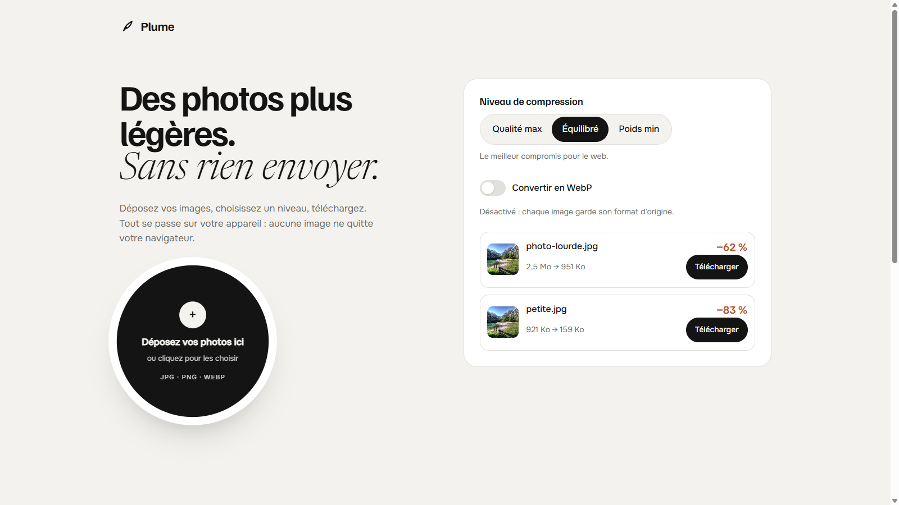

# Plume · Des images légères, sans quitter votre navigateur

> Jour 12 du défi **30 jours, 30 projets** · JavaScript · Canvas · Web Workers · 🚧 **Prêt, mise en ligne à venir**



Plume réduit le poids de vos photos pour le web. Vous déposez vos images, vous choisissez un niveau de compression, puis vous téléchargez le résultat. Tout se passe dans votre navigateur : aucune image n'est envoyée sur un serveur.

📄 Ce qui a été construit, règle par règle : le [cahier des charges](CAHIER_DES_CHARGES.md).

## Fonctionnalités

- Dépôt de plusieurs images (JPEG, PNG, WebP) par glisser-déposer ou sélection.
- Trois niveaux : **Qualité max**, **Équilibré** (par défaut), **Poids min**.
- Format d'origine conservé par défaut ; une option convertit en WebP, plus léger (désactivée si le navigateur ne sait pas en produire).
- Poids avant et après, gain en pourcentage, téléchargement image par image (`photo-plume.jpg`).
- Jamais plus lourd : si la compression ne gagne rien, l'original est gardé.
- Messages clairs par image : format refusé, image illisible, image de plus de 40 mégapixels, conseil WebP pour les PNG.
- Compression dans des Web Workers (3 à la fois) : la page reste fluide pendant un lot.
- Accessible au clavier, progression annoncée aux lecteurs d'écran, mouvement réduit respecté.

Exemple mesuré : une photo de 2,5 Mo passe à 951 Ko en « Équilibré » (−62 %), à 405 Ko en WebP (−84 %).

## Lancer en local

```bash
npm install
npm run dev          # http://localhost:5173
npm test             # 44 tests (node --test)
npm run build        # site statique dans dist/
```

## Structure

```
index.html            La page : outil, section avant/après, pied de page
src/
├── main.js           Interface : dépôt, réglages, résultats, workers
├── compress.js       Compression Canvas / OffscreenCanvas, règle « jamais plus lourd »
├── worker.js         Compression hors de la page
├── batch.js          Lot de fichiers, 3 à la fois, erreurs isolées
├── settings.js       Niveaux, formats, noms, limites, messages
├── format.js         Poids lisibles, gain, annonces de progression
├── reveal.js         Rideau avant/après et apparitions au défilement
└── styles.css
tests/                Tests node --test de la logique
public/               og.png, favicon.svg, robots.txt, sitemap.xml
docs/                 Capture du README, planche de direction artistique
```

## Mise en ligne

Prévue sur Coolify (site statique, build `npm run build`, dossier `dist/`) : **https://plume.projectp.fr**.

## Stack

JavaScript (modules, sans framework), Canvas, Web Workers, Vite. Polices Familjen Grotesk, Newsreader et Onest. Crédits dans [CREDITS.md](CREDITS.md).

## Avant de déclarer le projet terminé

- **Indexation** : `robots.txt`, `sitemap.xml`, balise canonical, données structurées JSON-LD (`WebApplication` rattachée à ProjectP) et lien « 30 jours, 30 projets » vers https://projectp.fr/ dans le pied de page. Vérifier en ligne, puis soumettre `https://plume.projectp.fr/sitemap.xml` dans Google Search Console.
- **Aperçu du lien** : image Open Graph stylisée 1200 × 630 aux couleurs du projet et balises `og:*` / `twitter:card`, vérifiées en ligne.
- **Vitrine** : la mise à jour de `30days30projects` (README et `projects.js`) se fait après validation.
